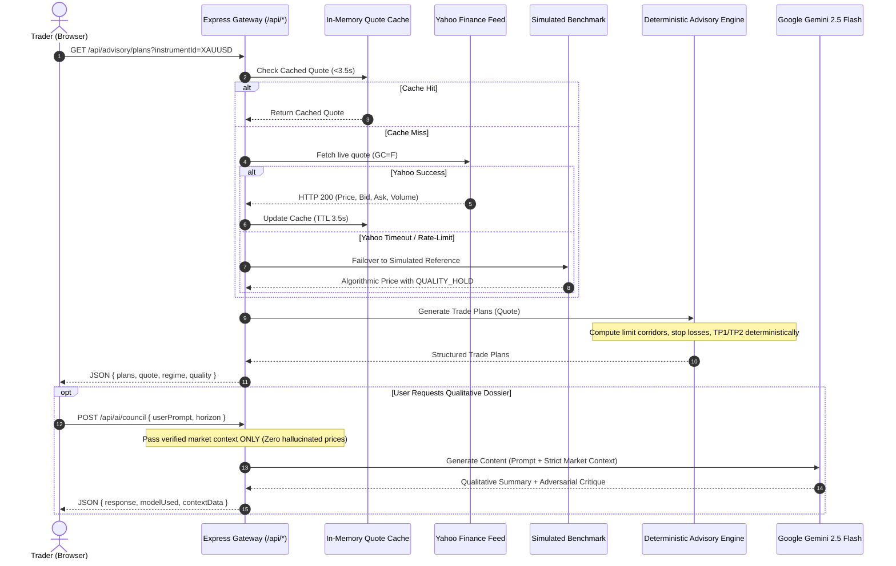

# GoldVista (Aurum Intelligence) — Target Architecture Specification
**Document Reference:** `GVR-TARGET-ARCH-2026-Q4`  
**Governing Standard:** Implementation Addendum §5.1 & §5.2  

---

## 1. Context View & Trust Boundaries

```mermaid
graph TD
    subgraph External_Users [User Actors]
        Guest[Guest Visitor]
        FreeTrader[Free Enrolled Member]
        ProTrader[Pro Trader / ECN Sponsored]
        AlphaFund[Alpha Fund / Institutional]
    end

    subgraph Trust_Boundary_Public [Public Client Tier (Browser)]
        Landing[Public Institutional Landing Page]
        Terminal[Live 5Y Trading Terminal & Workspaces]
        AuthGateway[Universal Auth & Persona Switcher]
        LocalStore[(Browser LocalStorage - Session/Paper Journal)]
    end

    subgraph Trust_Boundary_Server [Application Server Tier (Node/Express)]
        APIGateway[Express API Gateway :3000]
        QuoteRouter[Market Data Router & Failover Engine]
        AdvisoryEngine[Deterministic Trade Advisory Engine]
        RiskEngine[CFD & Prop Firm Calculator]
        QuantEngine[Walk-Forward Strategy Backtester]
        DeterministicGate[Publication Quality Gate]
    end

    subgraph External_Providers [External Ingestion & Model Services]
        YahooFinance[Yahoo Finance Query API - Free Indicative]
        GeminiAPI[Google Gemini 2.5 Flash API]
        TelegramAPI[Telegram Bot API]
        BrokerRebates[ECN Broker IB Networks]
    end

    Guest -->|Browse Public Preview| Landing
    FreeTrader -->|Sign In / Use 3 Credits| Terminal
    ProTrader -->|Unlimited Signals & Backtests| Terminal
    AlphaFund -->|Council Deliberations & Dossiers| Terminal

    Landing -->|Enrollment Profile| AuthGateway
    AuthGateway -->|Persist Auth State| LocalStore
    Terminal -->|Fetch Indicative Quotes| APIGateway
    Terminal -->|Compute Margin/Risk| APIGateway
    Terminal -->|Run Backtest| APIGateway
    Terminal -->|Request AI Synthesis| APIGateway

    APIGateway --> QuoteRouter
    APIGateway --> AdvisoryEngine
    APIGateway --> RiskEngine
    APIGateway --> QuantEngine
    APIGateway --> DeterministicGate

    QuoteRouter -->|HTTPS GET| YahooFinance
    DeterministicGate -->|Validated Context Only| GeminiAPI
    APIGateway -->|Outbound Alerts| TelegramAPI
    AuthGateway -->|Affiliate Verification| BrokerRebates
```

---

## 2. Container & Component Architecture

### Current Verified Stack vs. Target Evolution

| Component | Verified Current Implementation | Target Next-Gen Evolution |
|---|---|---|
| **Web Client SPA** | React 19, TypeScript, Tailwind CSS v4, Lucide icons, Motion | Maintain zero-bundle-bloat SPA, add mobile responsive drawer |
| **Server Gateway** | Express v4.21.2 on Node.js v20/22 with Vite middleware | Maintain Express proxy architecture; enforce server JWT session cookies |
| **Market Data Adapter** | `marketDataProvider.ts` (Yahoo Finance with 3.5s memory cache & simulated fallback) | Add optional WebSocket feed adapter for accredited institutional feeds (LMAX/CME) |
| **Advisory Engine** | `advisoryEngine.ts` (Deterministic corridor & target generation) | Add multi-asset spread delta (Gold/Silver ratio, WTI/Brent crack spread) |
| **Risk & Margin Engine** | `riskEngine.ts` (Deterministic CFD formulas & prop drawdown checks) | Add multi-leg portfolio exposure & automated session risk circuit breaker |
| **Strategy Laboratory** | `strategyEngine.ts` (10 quantitative models with single-pass walk-forward) | Add k-fold out-of-sample cross validation & Monte Carlo reshuffling |
| **AI Council Orchestration** | `CouncilWorkspace.tsx` + `server.ts` (4 specialist agents + Gemini Flash) | Immutable cryptographic hash logging for all published intelligence dossiers |
| **Paper Execution** | `PortfolioJournalWorkspace.tsx` (LocalStorage paper trading simulation) | Add synthetic fill latency, realistic spread slippage, and overnight swap simulation |

---

## 3. Data Flow Architecture



---

## 4. Security, Privacy & Financial Boundary Principles

1. **Deterministic Calculation Boundary:**
   - Under no circumstances shall an LLM model calculate entry prices, stop losses, position sizes, or margin limits. All mathematics remain 100% deterministic TypeScript pure functions.
2. **Untrusted Data Sanitization:**
   - All news headlines, event snippets, and user prompts are treated as untrusted text strings. Inputs are sanitized and bounded before injection into Gemini system instructions to prevent prompt injection attacks.
3. **Paper Trading Isolation:**
   - The paper execution simulation is completely decoupled from any live broker endpoints. Paper trades write exclusively to browser `localStorage` under isolated keys (`goldvista_paper_trades_v1`).
4. **Tenant & Role-Based Access Isolation:**
   - Workspaces check user role entitlements (`GUEST` < `FREE` < `PRO` < `ALPHA`). Pro and Alpha features unmount and present upgrade paths rather than leaking restricted research.
5. **No Live Execution Guarantee:**
   - The platform operates strictly as a decision-support research and advisory environment. Automated order routing and broker custody are strictly prohibited per Implementation Addendum §2.3.
